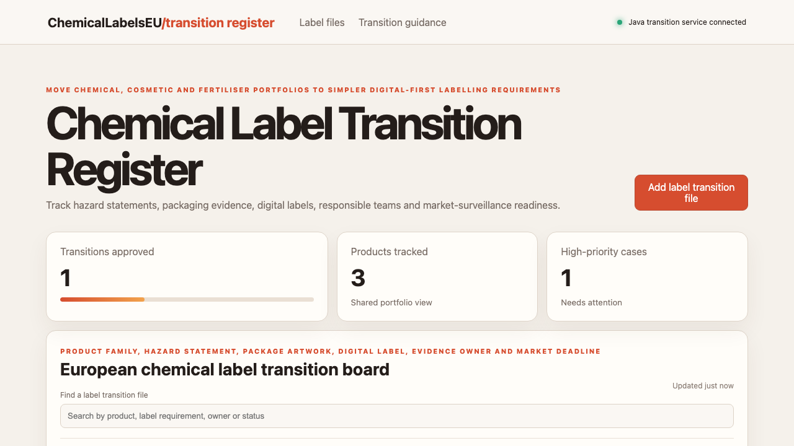

# Chemical Label Transition Register

## One-sentence benefit

Coordinate safer, simpler label changes across chemical, cosmetic and fertiliser product portfolios.

## Live demo

[Watch the workflow](docs/demo.webm).

## Screenshots

## Main features

- Search and sort transition files by product, owner, priority or approval state.
- Create and advance live label-change records through a Java API.
- Track package artwork, hazard statements, digital labels and market deadlines.
- Provide loading, empty and error feedback in a responsive register.

## Technology used

Angular, TypeScript, signals, computed state, HttpClient, Vite, Spring Boot and Java 21.

## Installation instructions

Install Node.js 22 and Java 21. Run `npm install`, start `cd backend && mvn spring-boot:run`, then run `npm start`.

## Commercial licensing/contact

Commercial licensing and integration support are available through the repository contact options.

## Business problem and users

Manufacturers, responsible persons, laboratories and market-surveillance teams need controlled evidence when label requirements change across portfolios.

## Key workflows

Search a file, create a portfolio transition, assign an owner, advance approval and review implementation guidance.

## Angular framework highlights

Signals and computed values provide fine-grained state, OnPush limits work and HttpClient performs typed server reads and writes.

## Java backend highlights

Spring Boot provides validated list, search, create and update APIs, structured errors, service separation, health status and tests.

## Architecture and state flow

Angular calls `/api/items`; Java validates data, the service owns transitions and signals update from returned records.

## Accessibility and responsive behaviour

Semantic sections, labelled controls, status messages, visible priorities and responsive grids support keyboard and narrow-screen use.

## Verification commands

Run `npm test`, `npm run lint --if-present`, `npm run build`, `cd backend && mvn test` and `cd backend && mvn package`.

## Structure

`src/app` contains Angular, `backend` contains Java and `docs` contains inspected media.

## Tradeoffs

The register uses memory data and simple states; production needs product master data, artwork files, signatures and retention policies.

## Roadmap

Add portfolio imports, version comparison, multilingual artwork checks, deadlines and market-surveillance exports.
